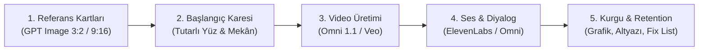

# AI FILM & SERIES MD (ai_film_series_md) — AI Film & Dizi Yapım Deposu

Bu depo, yapay zekâ araçları (GPT Image, Google Veo, Gemini Omni 1.1 Flash, ElevenLabs) kullanılarak üretilen sinematik kısa filmler, dikey drama dizileri ve video kurgu pipeline'larının eksiksiz senaryo, prompt, referans ve kalite kontrol dokümantasyonunu içerir.

Depodaki tüm projeler modüler bir yapıda, kaynak sohbet dökümlerinin bütünlüğü bozulmadan ("bozmadan hazırla" prensibiyle), kopyalanabilir prompt kod blokları, kurgu tabloları ve `.manifest.tsv` satır eşleşmeleriyle arşivlenmiştir.

---

## 🎬 Projeler Kataloğu

| Proje Klasörü | Tür / Tema | Format | Bölüm / Sahne | Ana Araçlar | Durum |
|---|---|---|---|---|---|
| [**Stay_In_The_Dark**](file:///Users/dai/github/apex_md/film_pro_max_md/Stay_In_The_Dark) | Post-Apokaliptik Zombi Gerilim | 16:9 Yatay Sinematik (~30 dk) | 6 Bölüm, 29 Sahne | Gemini Omni, GPT Image | Kurgu & Prompt Paketi Hazır |
| [**Last_Signal**](file:///Users/dai/github/apex_md/film_pro_max_md/Last_Signal) | Psikolojik Bilim Kurgu Gerilim | 9:16 Dikey (~1 dk/bölüm) | 5 Bölüm (Tam Seri) | Omni 1.1 Flash, GPT Image, ElevenLabs | 5 Bölüm + 16 Adımlı Editör Raporları |
| [**Save_Them_Or_Die**](file:///Users/dai/github/apex_md/film_pro_max_md/Save_Them_Or_Die) | Orta Çağ Sistem Fantezisi | 9:16 Dikey (~1 dk/bölüm) | Fragman + 3 Bölüm | Google Veo, Omni, ElevenLabs | Fragman, Bölüm 1–2 + Bölüm 3 Taslağı |
| [**Ic_Guvey**](file:///Users/dai/github/apex_md/film_pro_max_md/Ic_Guvey) | İntikam & Fiziksel Dönüşüm Draması | 9:16 Dikey (~1 dk/bölüm) | 2 Bölüm + 10 Bölüm Planı | Omni 1.1 Flash, GPT Image | Bölüm 1–2 Tam + Fix List & Studio Analizi |

---

## 📂 Proje Detayları ve İçerik Haritası

### 1. [Stay In The Dark (Karanlıkta Kal)](file:///Users/dai/github/apex_md/film_pro_max_md/Stay_In_The_Dark)
- **Kural:** Zombiler duymaz, karanlıkta göremez; fakat en ufak bir ışık kaynağına koşarlar.
- **Karakterler:** Ellie, Kyle, Frank, Kurye Marco, Mrs. Doyle.
- **Klasör Yapısı:**
  - `00_Referanslar/`: Karakter ve mekân referans promptları (#1–#9).
  - `00_Genel/`: Sahne 13 sonrası ara planlar ve kural güncellemeleri.
  - `Bolum_1_Soguk_Acilis/` — `Bolum_6_Final/`: Sahne sahne video/görsel promptları.
  - `Fragman_ve_Kapak/`: Teaser, dikey fragman kesimi, film afişleri.
  - `Arastirma/`: Model değerlendirme raporları ve Yapım Rehberi v2.

### 2. [Last Signal (Son Sinyal)](file:///Users/dai/github/apex_md/film_pro_max_md/Last_Signal)
- **Kural:** Meridian yörünge istasyonunda oksijen sızıntısı. Yapay zekâ VESPER her krizde bir bedel ister. Ortaya çıkan klon ikiz ve Dünya penceresi, acil durumların kaza değil bir eleme testi olduğunu gösterir.
- **Karakterler:** Komutan Ada Voss (v1/v2/v3), Uyanan Ada (İkiz), Robot MARLOW, Yapay Zekâ VESPER (Victoria sesi).
- **Klasör Yapısı:**
  - `00_Referanslar/`: Karakter ve mekân referans kartları rehberi.
  - `00_Genel_ve_Kurallar/`: Ses tasarımı (Victoria seçimi), Omni 1.1 Flash 60 sn şablonu.
  - `Bolum_1_Tehlike/` — `Bolum_5_Purge/`: 5 bölümün eksiksiz klip promptları (11–12 klip/bölüm).
  - `Raporlar_ve_Analiz/`: 16 adımlı Senior Editor & Retention Analiz Şablonu, 2 tam kalite denetim raporu ve Bölüm 5 dersleri.

### 3. [Save Them or Die (Kurtar Ya Da Öl)](file:///Users/dai/github/apex_md/film_pro_max_md/Save_Them_Or_Die)
- **Kural:** Rowan mezarlıkta ölümün eşiğindeyken Kader Sistemi uyanır: Açık artırmadaki üç kadını kurtar ve sadakatlerini kazan ya da kum saati sıfırlandığında öl.
- **Karakterler:** Rowan, Elara (düşmüş lordun kızı), Mira (savaşçı abla), Sera (hain şarkıcı), Cedric (soylu rakip).
- **Klasör Yapısı:**
  - `00_Referanslar/`: Karakter ve Kostüm A/B/C referans kartları.
  - `01_Fragman_ve_Genel/`: 64–72 sn MOD A kanca fragmanı, Veo promptları, YouTube İngilizce başlık ve açıklamaları.
  - `Bolum_1_Mezarcinin_Evi/`: Ritim/kanca analizleri, Klip 4–9 promptları, müzik ve anlatıcı yerleşimi.
  - `Bolum_2_Hain_Kim/`: İki motorlu paralel kurgu, Klip 1–10 promptları, sadakat paneli.
  - `Bolum_3_Seranin_Bedeli/`: Kadınlar kancası ve 9 klip ön hazırlığı.

### 4. [İç Güvey](file:///Users/dai/github/apex_md/film_pro_max_md/Ic_Guvey)
- **Kural:** Zengin aileye iç güvey giren, hor görülen Kerem'in aldatılma ve aşağılanmalar sonrası Cemal Usta'nın boks salonunda yaşadığı fiziksel/sosyal dönüşüm ve intikamı.
- **Karakterler:** Kerem (Faz 1: 145 kg, Faz 2: 105 kg, Faz 3: 88 kg), Rüya, Handan Hanım (Nevin), Cemal Usta, Kaan.
- **Klasör Yapısı:**
  - `00_Genel_ve_Referanslar/`: 10 bölümlük akış, Kerem fazları ve mekân kartları (Yalı, Boks Salonu).
  - `Bolum_1_Kapi_Disari/`: Aile yemeğinde tokat kancası, kovulma, Cemal Usta ile karşılaşma ve kapak promptu.
  - `Bolum_2_Yil_Donumu/`: Lüks restoranda pastaya basma kancası, KAAN girişi ve cliffhanger.
  - `Raporlar_ve_Dersler/`: YouTube Studio metrik kılavuzu (Viewed vs Swiped Away), Bölüm 1 Fix List ve yapım kuralları.

---

## 🛠️ Ortak Üretim Hattı ve Yapım Standartları (Pipeline)

Her projede uygulanan endüstri standardı yapım kuralları şunlardır:



### 1. Görsel & Yüz Tutarlılığı
- Asla sıfırdan her sahnede yeni yüz üretilmez. Onaylanan karakter referans kartı (Character Sheet) her prompta referans görsel olarak eklenir.
- Bir sahne içinde aynı kamera açısına dönüldüğünde yeni görsel üretilmez; onaylı başlangıç karesi yeniden kullanılır (Zincir kurgu).

### 2. Video Model Kuralları (Omni 1.1 Flash & Veo)
- **Süreler:** 4 sn (kanca, dış çekim, insert), 6 sn (tek replik + reaksiyon), 8 sn (karşılıklı diyalog), 10 sn (bölümün tek büyük doruk anı).
- **Kelime Sınırları:** Dudak senkronunun bozulmaması için 4 saniyede en fazla 8 kelime, 6 saniyede en fazla 12 kelime konuşulur.
- **Prompt Ayrımı:** Video promptlarında `SHOT`, `SCENE`, `SUBJECT`, `ACTION`, `CAMERA`, `LIGHTING`, `AUDIO`, `CONSISTENCY`, `AVOID`, `STYLE` blokları kesin çizgilerle tanımlanır.

### 3. Ses ve Diyalog Tasarımı
- Karakterlerin ses tonu ElevenLabs üzerinde spesifik aktör profilleriyle sabitlenir (örn: VESPER için *Victoria*, Sera için *Charmion*, Anlatıcı için *Chuck Miller*).
- Yapay zekâ seslerinde aşırı duygu/yankı ayrımı kurguda yapılır; oda yankısı, hoparlör filtreleri ve bilinçli sessizlik bölgeleri kurgu aşamasında yönetilir.

### 4. Dikey Format (9:16) ve Platform Kuralları
- **Güvenli Alan (Safe Area):** Altyazılar ve göstergeler ekranın %65–70 yüksekliğinde konumlandırılır; platform arayüz ikonlarının (beğeni, yorum, ses) arkasına yazı konulmaz.
- **Kanca (0:00–0:03):** İlk 3 saniyede izleyiciyi tutacak görsel ve işitsel bir olay (tokat, alarm, kum saati, flash-forward) verilir; ölü plan bırakılmaz.
- **Yapay Zekâ Beyanı:** YouTube Studio ve TikTok üzerinde gerçekçi modeller için "Altered or synthetic content" beyanı işaretlenir.

---

## 📋 Belgeleme Standartları

- **Metin Sadakati:** Kaynak sohbet dökümleri özetlenmeden, eksiltilmeden aktarılmıştır.
- **Tek Tıkla Kopyalama:** Tüm promptlar ` ```text ` blokları içindedir.
- **Doğrulama:** Her proje dizininde satır aralıklarını gösteren bir `.manifest.tsv` dosyası yer alır.
